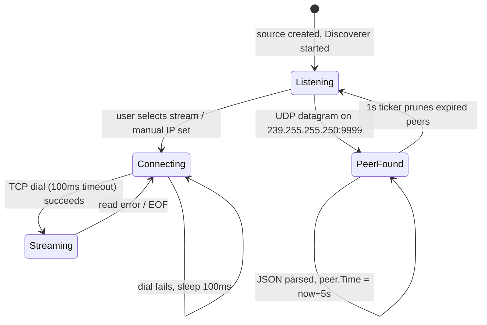
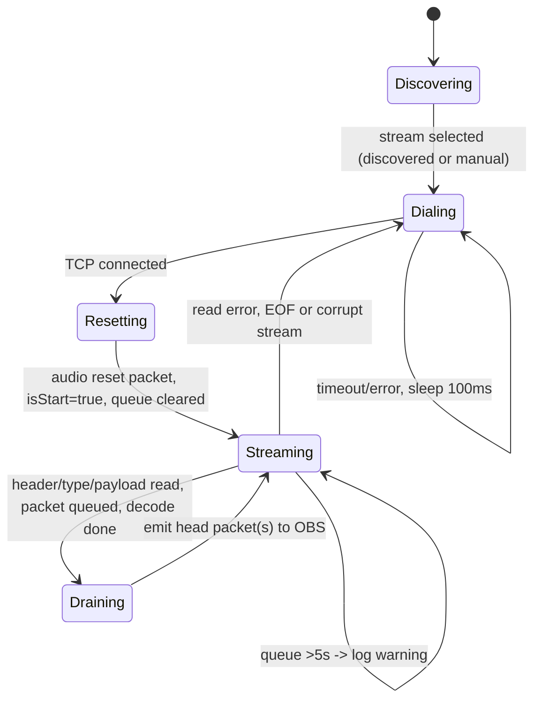
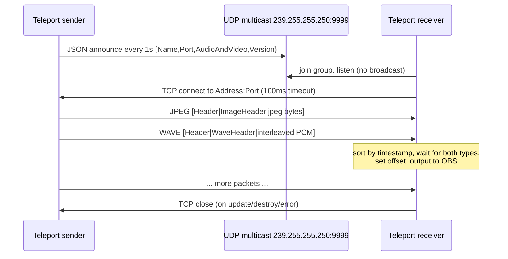

# PROTOCOL — original Teleport wire protocol & Wormhole v2

## Status and evidence basis

**Status:** Part 1 is reconstructed from **local source reading** of the exact
upstream artifact below. It is detailed enough to implement a compatible
receiver, but every statement is marked with its evidence class:

- `S` — read directly from source at the pinned commit (file and line given).
- `L` — read from a pinned dependency's source (file and line given).
- `C` — confirmed by a local packet capture / harness run (**none yet**;
  Phase 2).
- `U` — unknown / unverified.

No claim here relies on memory or on the project description. Capture-based
confirmation (`C`) is a Phase 2 deliverable; until then `PROTOCOL.md` is a
source-derived specification, not a captured one.

### Pinned artifacts

| Artifact | Identifier | Where |
|---|---|---|
| upstream obs-teleport (HEAD) | `e8c49f4be390ed17c434099541ce2fd65720e4c8` (2026-10-12, "fix linux CC names") | git-ignored `third_party/obs-teleport/` |
| upstream release tag `0.8.0` | `b61ee3c63f629bca75e7571bb7bdd151d8ee5aa6` (2026-09-17, "bump deps") | same clone, tag |
| release binary | `Teleport-0.8.0-Windows-x86_64.zip`, SHA-256 of extracted DLL `7BC1412CB289B36B3DB6736E48F1AA8CA1D06DB8F04ABEB25EFA81456A1E45C6` | `third_party/upstream-bin/` (git-ignored) |
| peerdiscovery dependency | `e0ee252378e1b36c6e9a70727043141556fc0d99` (v1.7.6) | `third_party/peerdiscovery/` |
| libjpeg-turbo | 3.2.0 (upstream CI builds it with `REQUIRE_SIMD=TRUE`) | `.github/workflows/build.yaml:29-36` |
| OBS libobs enums | OBS Studio 33.0.0 `libobs/media-io/{video,audio}-io.h` | fetched 2026-11-22 from obsproject/obs-studio tag 33.0.0 |

`git diff 0.8.0 HEAD` in the upstream clone changes only
`.github/workflows/build.yaml`; all Go/C source is byte-identical between the
release tag and the cloned HEAD. The release binary therefore corresponds to
the source described here (`S`).

---

# Part 1 — Original Teleport protocol

## 1.1 Transport and roles

| Property | Value | Evidence |
|---|---|---|
| Stream transport | TCP, one listener per sender (`net.Listen("tcp", ":"+port)`) | `S` output.go:235, filter.go:252 |
| Port setting | `port`, 0 = auto (ephemeral), default 0 | `S` frontend.go:204-216 |
| Connections | Many receivers per sender; one goroutine per connection | `S` sender.go:39-68 |
| Handshake | **None.** The receiver connects and immediately starts reading packets; the sender starts sending as soon as a connection is accepted | `S` source.go:530-562, output.go:247-258 |
| Version exchange | **Not on the wire.** Version is only advertised in the discovery payload and logged as a mismatch | `S` announcer.go:51-56, source.go:514-516 |
| Video start | Output mode begins data capture only after the first client connects | `S` output.go:254-257 |
| Idle behavior | With zero connections the output calls `obs_output_end_data_capture()` on each video frame; audio frames are dropped | `S` output.go:124-129, 198-200 |
| Filter mode | Filters listen continuously; callbacks pass frames through when no client is connected | `S` filter.go:152-154, 223-225 |

## 1.2 Discovery

Not mDNS. Teleport uses `github.com/schollz/peerdiscovery` v1.7.6 over IPv4
UDP multicast (`S` announcer.go:60-64, discoverer.go:43-65; `L` internal.go:22-40).

| Property | Value | Evidence |
|---|---|---|
| Multicast group | `239.255.255.250` (SSDP address, IPv4 default) | `L` internal.go:28-33 |
| UDP port | `9999` (library default; Teleport does not override `Port`) | `L` internal.go:22-24, `S` announcer.go:60-64 |
| Announcement interval | 1 s (library default `Delay`; Teleport does not override) | `L` internal.go:38-40 |
| Announcement payload | Raw JSON, no header/framing: `{"Name":"...","Port":N,"AudioAndVideo":bool,"Version":"..."}` — `Address` is `omitempty` and absent in announcements | `S` types.go:31-37, announcer.go:51-58 |
| `Name` | "identifier" setting, or OS hostname if blank, or `"(None)"` on error | `S` announcer.go:43-49 |
| `Port` | Actual listening TCP port (resolved from the listener after bind) | `S` output.go:261-268, filter.go:273-285 |
| `AudioAndVideo` | `true` for the output and the combined A/V filter; `false` for the video-only and audio-only filters | `S` output.go:268, filter.go:280-283 |
| `Version` | Build-time version (`0.8.0` in the release; `0.0.0` in source without `-ldflags`) | `S` main.go:125, `.github/workflows/build.yaml:2,66` |
| Receiver listen mode | `DisableBroadcast: true`, `AllowSelf: true` — receive-only, and accept announcements from the local host | `S` discoverer.go:43-47 |
| Service entry TTL | Receiver stores each peer with `now + 5 s`; entries older than that are pruned every 1 s | `S` discoverer.go:59-63, source.go:408, 572-579 |
| Manual connect | `manual-ip` setting `host:port`; takes precedence over the discovered list; `has-audio-and-video` checkbox supplies the A/V flag | `S` source.go:472-475, 79-84 |
| Source list key | `Name + ":" + Address` | `S` discoverer.go:59 |

### Discovery state (receiver)

## 1.3 Common packet framing

All packets are a fixed 16-byte header followed by a type-specific header and
`Size` payload bytes. Serialization is Go `encoding/binary.Write` with
`binary.LittleEndian` (`S` packet.go:118-123, 492-499), so fields are packed
field-by-field **without Go struct padding**.

### Header — 16 bytes (`types.go:39-43`)

| Offset | Size | Type | Field | Meaning |
|---|---|---|---|---|
| 0 | 4 | ASCII | `Type` | `JPEG`, `WAVE`, or other/unknown (see 1.6) |
| 4 | 8 | uint64 LE | `Timestamp` | OBS timestamp in nanoseconds (`frame.timestamp` / `frames.timestamp`) |
| 12 | 4 | int32 LE | `Size` | **Payload length only**, excluding both headers. May be 0 |

Wire length = `16 + type_header_len + Size`. There is no magic number, no
version field, no total-length field, no checksum and no sequence number.
`binary.Read` is used on both sides (`S` source.go:533), so a compatible
receiver must know the per-type header size before it can find the payload.

### Message types

| Type bytes | Meaning | Extra header | Payload |
|---|---|---|---|
| `JPEG` | Compressed video frame | `ImageHeader`, 88 bytes | JPEG bitstream, `Size` bytes |
| `WAVE` | Uncompressed PCM audio | `WaveHeader`, 16 bytes | Interleaved PCM, `Size` bytes |
| `ANJA` | Case exists in source but falls through to `default`; no sender emits it in this version | none | Receiver still reads `Size` bytes and dispatches as video (`U`: legacy format) |
| anything else | Unknown | none | Receiver still reads `Size` bytes and dispatches as video; decode panics and the packet is discarded (`S` source.go:549-552, 256-270) |

## 1.4 Video (`JPEG`) message

### ImageHeader — 88 bytes after the common header

`S` types.go:45-49, packet.go:121, output.go:160, filter.go:172-184.

| Offset | Size | Type | Field | Meaning |
|---|---|---|---|---|
| 0 | 64 | 16 × float32 LE | `ColorMatrix` | libobs `video_format_get_parameters()` matrix, or copied from `obs_source_frame.color_matrix` |
| 64 | 12 | 3 × float32 LE | `ColorRangeMin` | range minimum; full range is exactly `{0,0,0}` |
| 76 | 12 | 3 × float32 LE | `ColorRangeMax` | range maximum; full range is exactly `{1,1,1}` |

Payload: a JPEG bitstream produced by libjpeg-turbo 3.2.0 `tj3Compress*`
(`S` packet.go:53-124). Width, height and chroma subsampling are encoded in
the JPEG SOF marker — they are **not** sent as separate fields and there is no
resolution/FPS negotiation.

| Property | Value | Evidence |
|---|---|---|
| Codec | JPEG (libjpeg-turbo `tj3`, SIMD build) | `S` packet.go:54, utils.c:40-42 |
| Quality | Setting `quality`, int slider 1..100, default **90**; >90 warns | `S` frontend.go:192-199, 214 |
| Subsampling | YUV 4:2:0 (`TJSAMP_420`), 4:2:2 (`TJSAMP_422`) or 4:4:4 (`TJSAMP_444`), chosen from the source image | `S` packet.go:68-84 |
| Input pixel formats | NV12, I420, I422, YVYU, YUY2, UYVY, I444, BGRX, BGRA, BGR3, RGBA | `S` packet.go:234-445 |
| Output mode conversion | Non-I420/I444/BGRA sources are converted to I420 before encoding | `S` output.go:80-93, 147-153 |
| Output RGB path | BGRX/BGRA/RGBA are encoded as JPEG `TJCS_RGB` / 4:4:4 | `S` packet.go:93-106 |
| GPU path | None | `S` (absence) |

### Video pipeline and ordering

`S` output.go:131-191, filter.go:156-214:

1. OBS video callback constructs a `Packet` with the frame timestamp.
2. In output mode, `ToImage()` copies/converts OBS planes into a pooled
   `bytes.Buffer`; in filter mode the same happens with `obs_source_frame`.
3. The packet is appended to a queue while holding a mutex; the queue span is
   compared against 1 s and `laggedFrames` is incremented when exceeded.
4. A **new goroutine per frame** performs `ToJPEG()`.
5. When a frame's JPEG is done, frames are flushed from the head of the queue
   in timestamp order (a later frame cannot overtake an earlier one).
6. `SenderSend()` pushes the serialized buffer into every connection channel.

## 1.5 Audio (`WAVE`) message

Audio is **raw uncompressed PCM** — there is no Opus or any other codec
(`S` packet.go:450-549). This overturns the starting hypothesis in the master
prompt.

### WaveHeader — 16 bytes after the common header

`S` types.go:51-56, packet.go:485-495.

| Offset | Size | Type | Field | Meaning |
|---|---|---|---|---|
| 0 | 4 | int32 LE | `Format` | OBS `enum audio_format` value (see below) |
| 4 | 4 | int32 LE | `SampleRate` | samples/second, typically 48000 |
| 8 | 4 | int32 LE | `Speakers` | OBS `enum speaker_layout` value, **not** a channel count |
| 12 | 4 | int32 LE | `Frames` | number of sample frames in this packet |

Payload: `bytesPerSample × channel_count × Frames` bytes, **interleaved** by
frame then channel. Planar input is de-planarized in `ToWAVE()`.
`Header.Size` equals that payload length (`S` packet.go:479-483).

`Format` values from OBS 33.0.0 (`L`, `libobs/media-io/audio-io.h`):

| Value | Enum |
|---|---|
| 0 | `AUDIO_FORMAT_UNKNOWN` |
| 1 | `AUDIO_FORMAT_U8BIT` |
| 2 | `AUDIO_FORMAT_16BIT` |
| 3 | `AUDIO_FORMAT_32BIT` |
| 4 | `AUDIO_FORMAT_FLOAT` |
| 5 | `AUDIO_FORMAT_U8BIT_PLANAR` |
| 6 | `AUDIO_FORMAT_16BIT_PLANAR` |
| 7 | `AUDIO_FORMAT_32BIT_PLANAR` |
| 8 | `AUDIO_FORMAT_FLOAT_PLANAR` |

`Speakers` values (`L`): 0 unknown, 1 mono, 2 stereo, 3 2.1, 4 4.0, 5 4.1,
6 5.1, **8** 7.1 (7 is skipped). Channel count is derived from this enum via
`get_audio_channels()`; a compatible receiver must not treat it as a raw
channel count.

> **Compatibility hazard (`U` until captured):** older libobs versions used a
> different ordering of the audio-format enum (e.g. FLOAT=3 before 32BIT was
> added). Because the wire carries the enum integer verbatim, a receiver on a
> different OBS version can misinterpret formats. This must be verified with a
> capture from a sender built against an older OBS.

`S` packet.go:456-477 maps planar and packed input alike to the corresponding
**packed** format value on the wire, so a receiver only ever needs the packed
format numbers 1/2/3/4 in practice.

Audio is sent directly from the OBS audio callback (`S` output.go:211-213,
filter.go:236-238): there is no interleave queue with video, no backpressure
check beyond the per-connection channel, and no re-sampling.

## 1.6 A/V synchronization

`S` source.go:235-396:

- Both message types carry a nanosecond OBS timestamp in the common header.
- On connect the receiver initializes an `obs_source_audio` packet with
  `timestamp = MaxUint64`, 48000 Hz, 2 channels, FLOAT, 0 frames, and submits
  it once (silence/reset signal), then sets `isStart = true` and clears the
  queue (`S` source.go:518-528).
- Incoming packets are appended to a queue sorted by timestamp; each packet is
  decoded in its own goroutine.
- When `AudioAndVideo` is true, the receiver refuses to emit anything until at
  least one audio **and** one video packet are present in the queue
  (`S` source.go:284-295).
- The first emitted packet establishes `offset = queue[0].Timestamp`; all
  subsequent OBS timestamps are `packet.Timestamp - offset`
  (`S` source.go:297-307, 310, 349).
- The offset is recomputed once at stream start only (when the queue contains
  both kinds); there is no continuous clock drift correction.
- Packets are emitted strictly from the head of the queue once their decode is
  complete, so audio and video are played according to sender timestamps.

## 1.7 Sender behavior under load and failure

| Situation | Behavior | Evidence |
|---|---|---|
| No receivers | Video capture ends; audio dropped | `S` output.go:124-129, 198-200 |
| Per-connection queue | Buffered channel of 1000 buffers | `S` sender.go:49 |
| Queue > 100 | Warning "send queue high" | `S` sender.go:86-88 |
| Queue > 800 | Packet **dropped** for that connection, warning "send queue exceeded" | `S` sender.go:83-85 |
| Write error | Connection removed and closed | `S` sender.go:57-66 |
| Encode queue > 1 s timestamp span | Warning, `laggedFrames++` (reported as dropped frames) | `S` output.go:165-170, 216-224 |
| Decode queue > 5 s timestamp span | Warning only | `S` source.go:244-248 |
| Touching OBS threads | `ToImage()` and `obs_source_get_settings()` run in the video/audio callbacks; JPEG encode is offloaded to a goroutine, but the conversion and queue work are on the OBS thread | `S` output.go:131-191, filter.go:149-214 |

Note: the sender blocks the OBS callback when `SenderSend()` blocks on a full
per-connection channel (it only skips above 800), which is a concrete defect
Wormhole must not reproduce.

## 1.8 Receiver reconnect and error behavior

`S` source.go:399-565:

- Discovery runs continuously; a 1 s ticker prunes peers older than 5 s.
- Dial timeout is 100 ms; on failure the receiver sleeps 100 ms and retries
  forever until the source is updated or destroyed.
- On each (re)connect, state is reset: queue cleared, `isStart = true`, audio
  reset packet emitted, version mismatch logged if discovery advertised a
  different version.
- `binary.Read` errors or `io.ReadFull` errors break the read loop, which
  returns to the outer retry loop (`S` source.go:530-564).
- Corrupt JPEG panics inside the decode goroutine; a deferred `recover()` logs
  "jpeg corrupt, discarding.." and removes the packet from the queue
  (`S` source.go:256-270). Other panics restart `run()` after 1 s
  (`S` source.go:434-443).

### Receiver state machine

### Sequence diagram (no handshake)

## 1.9 CPU / memory profile (source observations, not measurements)

- One goroutine per video frame for JPEG compression; allocations include a
  fresh `[]byte` for the JPEG buffer and a `Packet` per frame
  (`S` packet.go:87, output.go:131).
- A `Pool` of 10 `*bytes.Buffer` values is used for image/pixel staging and
  decoded frames (`S` pool.go:27-52).
- Audio packets allocate a fresh `[]byte` per callback (`S` packet.go:497).
- Go GC and cgo crossings occur on every frame (libjpeg-turbo calls).
- **Measured** CPU/memory/GC numbers: `U` — `exp_000` has not been run.

## 1.10 Open questions / capture-verification backlog

| # | Question | Needed to close |
|---|---|---|
| Q1 | Byte-for-byte confirmation of the 16/88/16 header sizes | Phase 2 dissector + capture, `C` |
| Q2 | Actual `Speakers` and `Format` values on a live 48 kHz stereo stream | Capture from release binary, `C` |
| Q3 | Exact `ANJA` semantics / origin | Search full upstream history or capture; no sender emits it at this commit |
| Q4 | Older-OBS audio enum compatibility | Capture from an older sender build, `C` |
| Q5 | Measured latency, CPU, memory, bandwidth, A/V skew | `exp_000` + benchmark runner |
| Q6 | Behavior of the receiver's `MaxUint64` audio reset packet in OBS 33.0.0 | Integration test with mock/real OBS |
| Q7 | Multicast behavior per platform (Windows/Linux/macOS) | Platform tests, `C` |

## 1.11 Evidence index

| Evidence | Artifact / location |
|---|---|
| Go source at pinned commit | `third_party/obs-teleport/` (git-ignored), HEAD `e8c49f4…` |
| Release tag source identical | `git diff 0.8.0 HEAD` → only `.github/workflows/build.yaml` |
| Release binary | `third_party/upstream-bin/`, SHA-256 `7BC1412C…E45C6` |
| peerdiscovery v1.7.6 | `third_party/peerdiscovery/`, `e0ee252…` |
| OBS enum definitions | obsproject/obs-studio tag 33.0.0, `libobs/media-io/{video,audio}-io.h`, fetched 2026-11-22 |
| Build procedure and blockers | [HARNESS.md](HARNESS.md) |
| Harness decode/proxy fidelity (synthetic fixture) | [exp_001/FINDINGS.md](exp_001/FINDINGS.md) — round-trip byte-identical, proxy lossless |
| Independent reference-peer stream (real JPEG) | [exp_002/FINDINGS.md](exp_002/FINDINGS.md) — 10 JPEG + 10 WAVE, all decoded, framing round-trips |

---

# Part 2 — Wormhole protocol v2 (draft)

Status: draft. Will be locked in Phase 3 with an `ARCHITECTURE_LOG.md` entry
citing an `exp_NNN/`.

Requirements already fixed by the contract:

1. Versioned handshake that negotiates down to the Teleport-compatible mode
   automatically (Part 1 has no handshake at all, so v2 must detect a legacy
   peer without a v2 greeting).
2. Capability negotiation.
3. Stream descriptors with track IDs, names, formats and sample rates.
4. Multiple independent audio streams, sample-accurate relative to each other
   and to video.
5. Legacy fallback: track 1 is delivered as an ordinary Teleport `WAVE`
   stream to compatibility-mode peers.

Design constraints learned from Part 1 that v2 must address:

- Add a magic/version field so unknown packets are rejectable without panic.
- Add a total-length field (Part 1's `Size` is payload-only).
- Add sequence numbers and explicit clock domain so reordering and A/V sync
  do not depend on sorting a queue of raw timestamps.
- Carry speaker layout as a channel count plus explicit layout, not a raw
  libobs enum integer.
- Define bounded queues and explicit drop policy; never block an OBS thread.

## Part 2 addendum - v0.2 implemented messages

v0.2 adds WH2_CAP_SCENE_SYNC (1<<3) and messages SCENE_REQUEST=20, SCENE_MANIFEST=21, CONTROL=22. The manifest is a text frame with newline fields: V:<version>, A:<active scene>, T:<id>|<name>, S:<scene>, I:<name>|<kind>|<visible>|<track>|<muted>. It is pushed on connect and on state change. wh2_parse_text() returns the parsed string length or 0. Evidence: exp_018/FINDINGS.md.

